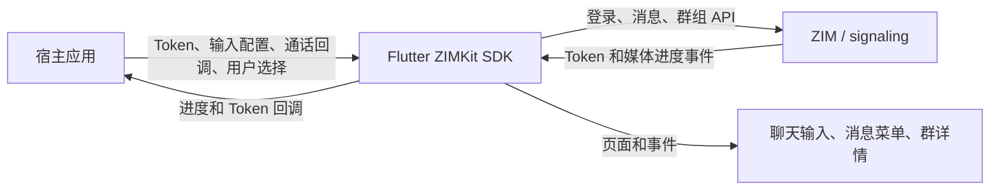

# ZIMKit 能力补齐设计

状态：已验收

基准：ZIMKit Flutter v2.0.0（2026-10-15 与 SDK 当前代码核对）

## 目标

把已确认的五项缺口补进 Flutter ZIMKit SDK：Token 登录与续期、输入框全局配置、群详情和成员管理、消息操作与表情配置、媒体消息类型识别和上传进度。all-in-one demo 只接入现有设置、聊天页、Call Kit 和用户选择入口，不改变五个 Kit 的初始化顺序、主路由和主时序。

实现分别位于 SDK 分支 `codex/zimkit-v2-parity` 和 demo 分支 `codex/zimkit-v2-parity-demo`。demo 仅接入现有页面与调用入口，不改变五个 Kit 的初始化顺序、主路由和主时序。

## 证据与原生端对齐

本次下载的原生 SDK 源码确认两端都把群详情/成员管理放在 SDK 内：

- iOS Swift 2.8.0 包含 `ZIMKit/Components/Group/ViewController/GroupDetailVC.swift`、`GroupMemberListVC.swift` 和 `ZIMKitInviteUserInGroupView.swift`。
- Android 2.9.4 源码包含 `ZIMKitGroupChatSettingActivity`、`ZIMKitGroupMembersActivity` 及 group 组件；官方消息组件文档也说明 Activity 可跳转到 ZIMKitGroup 提供的群组管理页面。
- 本地证据包位于 `/Volumes/adam/projects/uikits/temp/zego_inapp_chat_uikit_ios_swift-2.8.0.zip` 和 `zego_inapp_chat_uikit_android-2.9.4-source.zip`。两个包的版本不同，因此只用来确认功能归属和现有行为，不做版本差异结论。
- 官方 iOS 消息组件和 Android 消息组件文档都列出消息操作、输入框按钮和表情面板的定制项；Android Token 鉴权文档明确要求登录时传 Token。Flutter 将提供等价能力，按 Flutter API 习惯实现。

## 能力设计

### 1. Token 登录与续期

- 在 `connectUser` 增加可选 Token 参数；不传时保持现有登录路径。
- 增加公开的 Token 续期方法，调用底层 signaling/ZIM 续期接口，并将错误返回给调用方。
- 把底层 Token 即将过期事件和登录 Token 失效状态转发到已声明的 `ZIMKitConnectionEvents` 回调。
- Token 只由宿主服务生成并传入客户端；不在 Flutter SDK 或 demo 中存放 AppSecret。

### 2. 输入框配置生效

- 将 `ZIMKitConfig.inputConfig` 接入消息页输入框，让全局按钮顺序、展开区按钮、占位文案、最大常驻按钮数、自定义按钮和表情配置真正控制 UI。新增群详情页和展开区文案纳入 `ZIMKitInnerText` 与简体中文词典。
- 常驻按钮超过 `maxSmallButtonCount` 时放入展开区；显式配置的展开按钮仍保留。
- 页面级 `ZIMKitMessageInputConfigs` 的显隐选项继续有效，并过滤掉全局配置中被页面关闭的内置按钮。页面级 actions 继续附加在展开区。
- `voiceCall` / `videoCall` 按钮只通知宿主选择的通话类型，不直接依赖 Call Kit。补齐缺失的 typed `onCallTap` 事件。
- `emojis == null` 时保留现有完整表情选择器；显式传入非空列表时使用该列表作为输入区表情面板内容。

### 3. SDK 内群详情和成员管理页

新增公开的 `ZIMKitGroupDetailPage`，以群 ID 为入口，显示群资料、成员总数、群主和成员列表，并提供原生详情页已有的置顶与消息免打扰开关。群成员操作使用当前 SDK 已有群组 API 提供：

- 添加成员：由宿主通过回调选择用户 ID，SDK 页面执行加群操作。
- 移除成员、设置/取消管理员、转让群主：根据当前用户角色显示允许的操作。
- 群组 API 返回错误时给出可见反馈，不静默忽略。

页面不内置通讯录或用户搜索，因为用户目录归宿主应用所有。当前原生群详情页以成员列表、邀请入口、置顶和免打扰为主；Flutter 页在此基础上接入 Flutter SDK 已有的移除成员、角色和群主操作 API。首版不新增群名、头像、公告编辑 API；现有 Flutter ZIMKit 公开服务尚未提供这些写接口。群详情页和单聊详情页共用会话置顶/免打扰设置组件，避免复制逻辑。demo 从已有群聊详情入口打开新页面，并提供输入用户 ID 的回调；SDK 页面统一执行邀请操作，避免 demo 与 SDK 重复调用。单聊详情仍走当前页面。

### 4. 消息操作和表情配置生效

- 长按菜单按 `ZIMKitMessageConfig.getOperationsByMessageType` 生成操作项，继续按消息类型、发送者身份校验复制、扬声器和撤回等操作的适用条件。
- `reaction` 配置控制是否显示消息表情操作；`messageReactions` 自定义快捷表情。未设置时保留当前快捷表情，显式空列表时隐藏快捷表情区。
- 合并消息默认操作补上原生文档列出的回复和撤回能力；其他消息类型保持既有默认项。

### 5. 媒体类型识别和上传进度

- `sendFileMessage(autoDetectType: true)` 按文件扩展名选择图片、视频、音频或普通文件类型；传 `false` 时强制按普通文件发送。
- `sendFileMessage` 和 `sendMediaMessage` 都把每次调用的上传进度回调传到底层。
- 上传和下载期间继续更新消息本地状态，并派发已声明的 `onMediaTransferProgress`，携带消息、当前/总大小和 `isUploading` 标记；图片消息使用 SDK 图片缓存的下载进度；每次发送调用的进度回调只报告上传。
- 多文件发送按顺序等待发送结果，错误沿用现有 Future 返回语义，不因新增进度处理被吞掉。

### 6. 语音录制浮层和锁定交互

- 按住麦克风开始录音，浮层显示暗色遮罩、录音时长和持续变化的声浪动画；不显示语音转文字文案。
- 按住时底部浅灰面板显示随声浪起伏的上沿、录音时长、锁定操作、左滑取消提示和麦克风图标，不显示“按住说话”或“松开发送”等辅助提示。向上拖到锁定操作并松手后锁定，操作按钮高亮并给触感反馈。
- 左滑进入深灰取消预览，锁定操作显示“松开取消”；滑回恢复录音，松手才真正取消。
- 锁定后松开手指仍继续录音，时长和声浪动画继续；底部面板变为蓝底白字并提供“丢弃”和“发送”两个按钮，不显示“录音已锁定”提示。“丢弃”会结束并丢弃当前录音，读屏说明为“丢弃当前录音”；锁定期间不能切回文字输入。
- 录音不足 500ms 时松手会取消，不发送；锁定态的“发送”按钮在录音达到 500ms 后启用。
- 读屏用户点按“按住说话”入口时直接开始锁定录音，再通过浮层中的“丢弃”或“发送”完成操作。
- 浮层显示期间将读屏焦点限制在浮层内容和可用操作内，底层聊天控件不参与语义遍历。
- 输入栏背景延伸到屏幕底部安全区，避免聊天页底部出现突兀的留白色块。
- 声浪优先使用实时音量驱动；如果当前录音 API 不提供音量数据，则使用持续、柔和的动效表达录音状态，不暗示波形精确代表音量。
- 发送、取消、启动失败、录音失败、超时和聊天页销毁都回到普通输入界面并清理锁定状态；聊天页销毁时取消尚未结束的录音。已开始的发送在输入组件销毁后仍由录音请求完成回调处理。
- 通用 ZIMAudio SDK 异常只记录日志；录音失败由录音专属失败事件处理。ZIMKit 同时只保留一个待结束的录音会话；反初始化等待启动和终态事件时有时间上限，超时仍会释放底层音频并清除待处理会话。终态或原生反初始化失败/超时后录音事件会被隔离，只有原生 ZIMAudio 反初始化成功后才解除；隔离期间拒绝新录音，避免无会话 ID 的迟到事件误结束新会话。读屏入口启动录音后，收到录音开始事件前发送和丢弃操作不可用，界面不显示启动提示；快速松手会等录音就绪后再完成或取消。页面在开始事件前销毁时，取消请求附着在该录音会话上，等录音真正启动后再取消。`uninit` 一开始就关闭新录音入口，原生清理结束前不会接收新的启动请求。原生发送完成或取消请求失败时会通知失败回调并隔离事件，直到原生反初始化成功。
- 取消的启动请求不会因迟到的 Future 完成而取消之后启动的录音会话。

## demo 边界

- 使用现有 `appToken` 设置登录 ZIMKit；保留 appID 和用户输入流程。
- 保持现有 `ZIMKit.init`、Call Kit 系统呼叫 UI 设置、`initCallInvitation` 的先后关系及其周边初始化流程。
- 在现有聊天页接入输入框通话回调和群详情页入口。单聊邀请会话对方；群聊先查询完整成员列表并排除发起者，再通过现有 Call Kit 发起群呼叫。ZIM CallInvite 单次最多邀请 9 人，群成员超过此上限时显示选择页，由用户选择本次通话对象。
- demo 将语音/视频按钮放入展开区并调用现有 Call Kit 发送逻辑；单聊和其他 Kit 的页面及主流程不改。

## 验收方式

- 为新增的消息操作映射、文件类型选择、输入配置归并等确定性逻辑先写单元测试，再写实现；新逻辑覆盖率目标为 80%。
- 执行 SDK 测试和静态分析。
- 在 demo worktree 临时用 path dependency 指向 SDK worktree，不提交覆盖文件；分别构建 Android debug APK 和 iOS no-codesign 产物。
- 检查两个 worktree 的 diff，确认原始 demo 仓库和其未提交内容未被修改。

## 流程图

## 主要依据

- [Android 消息组件与群管理入口](https://doc-zh.zego.im/in-app-chat-kit-android/ui-components/message-component)
- [Android Token 鉴权](https://doc-zh.zego.im/in-app-chat-kit-android/advanced-features/use-tokens-for-authentication)
- [iOS 消息组件与定制功能](https://doc-zh.zego.im/in-app-chat-kit-ios/ui-components/message-component)
- Flutter 当前实现：`lib/src/services/user_service.dart`、`lib/src/services/core/user.dart`、`lib/src/config.defines.dart`、`lib/src/components/messages/input/`、`lib/src/components/messages/widgets/long_press_menu.dart`、`lib/src/services/message_service.dart`、`lib/src/services/core/message_media.dart`。
